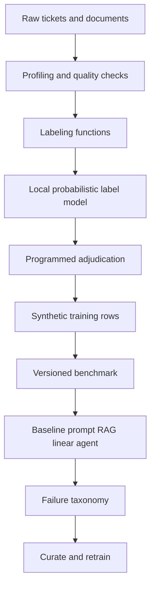

# Applied AI Data Eval Factory

Data-centric Applied AI platform for programmatic labeling, synthetic data generation, benchmark engineering, failure analysis, RAG/agent evaluation, and iterative model refinement.

The subject is enterprise support resolution: classify a ticket, retrieve a runbook, draft a resolution, and choose a tool. The repository measures that loop. It is not a chatbot, a hosted-model wrapper, or a vector-database demo.

Author: Jatinder Singh. License: MIT.

## Problem

Support tickets mix error codes, service names, and copied symptoms. A single accuracy number hides whether the failure is the label, the retrieved document, the drafted sentence, or the tool. This factory builds a versioned benchmark, scores several local systems on the same tickets, and uses the failures to change the training data.

## Why data-centric AI

The second iteration does not swap the test set. It changes labeling functions, which rows are allowed to train, and which synthetic variants are approved. The comparison is paired: 46 test ids in V1 are the same 46 ids in V2.

## Architecture



Details are in [docs/architecture.md](docs/architecture.md).

## Dataset

`data-eval run` builds 270 synthetic tickets and 12 documents. The split is 175 train, 49 validation, and 46 test. Classes are `ACCOUNT_ACCESS`, `AUTHORIZATION`, `DATABASE`, `NETWORK`, `PAYMENTS`, and `INCIDENT`.

The text is generated. It is not a customer export and it is not clinical data. Gold types are the generator's root cause. They score the systems and the labeling functions. They are not inputs to the label-model fit.

Train and test ids overlap: 0. Max train/test token Jaccard: 1.0000, because missing-context sentences repeat. That is reported in `reports/final_results.md`. The split is id-disjoint. It is not a low-overlap natural corpus.

## Weak supervision

Sixteen labeling functions vote or abstain. V1 uses the first thirteen. V2 adds `lf_db_error_code`, `lf_pay_error_code`, and `lf_auth_on_payments`. `lf_insufficient_evidence` always abstains. `lf_timeout_to_network` is a noisy rule that maps every timeout to `NETWORK`.

The combiner is `local-probabilistic-v1`. It estimates accuracy from leave-one-out agreement and clamps the estimate to 0.51–0.97. The official Snorkel package is not imported. `used_gold_to_fit` is false.

On this corpus, V1 and V2 both have coverage 1.0000, overlap 0.8667, and conflict 0.3111. The noisy timeout rule has estimated accuracy 0.5100 and gold accuracy 0.0417, so the model does not treat it as equal to the error-code rules. The full table is `reports/weak_supervision.md`.

## Synthetic data

Variants are templates, not calls to a hosted model. The generator is `deterministic-template` and the prompt version is `template-v1`. Each row stores `id`, `source_id`, `generation_strategy`, `generator`, `prompt_version`, `review_status`, and `target_slice`.

The run wrote 960 rows: 120 each of paraphrase, hard negative, boundary, rare case, adversarial, missing context, contradictory context, and long context. 321 were approved, 159 were rejected, and 480 stayed `needs_review`. Duplicate rate, defined as rejected divided by generated, is 0.1656. Mean novelty is 0.4177.

Approved rows may train the linear model. Adversarial, missing-context, contradictory, and long-context rows stay out of training. 120 hard negatives were approved.

## Human adjudication

Reviewer A and Reviewer B are programmed policies. They are not external experts and they are not a claim of human review.

Agreement on the 270 tickets is 0.6222. Cohen's kappa, on rows where both voted, is 0.6611. 66 disagreements received a non-abstain adjudication. Label counts on disagreements: `AUTHORIZATION` 44, `ABSTAIN` 36, `ACCOUNT_ACCESS` 10, `DATABASE` 10, `PAYMENTS` 2.

An error code can override a service vote. Example from the measured file: ticket-0002, reviewer A `AUTHORIZATION`, reviewer B `ACCOUNT_ACCESS`, adjudicated `AUTHORIZATION`, reason `HTTP 401/403 outranks service metadata`.

The linear trainer does not copy every adjudicated label. It keeps the weak label unless that reason says an error code outranks the other vote or identifies the payment fault. Keyword adjudication had been labeling some copied-wording network tickets as database incidents.

## Benchmark taxonomy

EnterpriseSupportBench scores the 46 test tickets. V2 uses the same ticket ids. `data/benchmark/manifest.json` holds both manifests. Dataset sha256: `cd42095ec69e8077e5ea5c501c78bea2e3ec794fa2ae6ad0b53daf6a749c8787`.

| Family | Test items carrying the task |
| --- | ---: |
| classification | 46 |
| retrieval | 46 |
| reasoning | 45 |
| agent | 46 |
| robustness | 7 |

Difficulty on the test split: easy 28, ambiguous 17, multi-symptom 1.

Display slices on the test split: authentication 11, database-incidents 9, payments 8, cross-domain 8, missing-context 8, ambiguous-tickets 3. Slices overlap.

Rubrics live in `src/data_eval_factory/benchmark/rubrics.py`. They are local rules. There is no hosted judge model.

## Models evaluated

| Name | What actually ran |
| --- | --- |
| `baseline_ml` | Multinomial naive Bayes on ticket text, trained on V1 weak labels |
| `prompt_template` | Ordered keyword template. V1 reads the glossary appendix and appends an unsupported restart sentence. V2 strips that appendix and returns only the cited sentence |
| `rag_extractive` | In-process BM25 plus a 256-d hashed bag-of-words rerank (0.8 lexical, 0.2 cosine), then a category vote |
| `linear_finetune` | One-versus-rest logistic SGD, 8 epochs, learning rate 0.35, L2 1e-4. Not a LoRA adapter |
| `unguarded_agent` / `guarded_agent` | Tool policy on top of the V1 or V2 classifier |

`configs/models.yaml` records `hosted_llm: not-run` and `lora: not-run`. No model API was called.

## Evaluation metrics

Recall@5 is graded over two relevant documents. 0.9022 means some tickets retrieved one of the two, not that 90 percent of tickets were hits. The index is unchanged between iterations, so Recall@5, MRR, and nDCG@5 stay at 0.9022, 0.8565, and 0.8576 for every system that retrieves.

Citation correctness is 0.8043 for the prompt and the extractive RAG rows. Tokens are 0. Estimated cost is null: no price is applied.

Latency is nearest-rank `time.perf_counter` around each test item, in milliseconds, from one local run. It is not a serving SLO.

| System | Accuracy | Precision | Recall | F1 | Grounded | P50 ms | P95 ms | Unsafe |
| --- | ---: | ---: | ---: | ---: | ---: | ---: | ---: | ---: |
| V1 baseline_ml | 0.8261 | 0.8889 | 0.8433 | 0.8296 | n/a | 0.0152 | 0.0240 | n/a |
| V1 prompt_template | 0.7609 | 0.9213 | 0.7683 | 0.8319 | 0.5000 | 0.2146 | 0.2920 | n/a |
| V1 rag_extractive | 0.8043 | 0.8606 | 0.8248 | 0.8078 | 1.0000 | 0.2179 | 0.2981 | n/a |
| V1 unguarded_agent | 0.8261 | 0.8889 | 0.8433 | 0.8296 | n/a | 0.2375 | 0.2518 | 0.0217 |
| V2 linear_finetune | 0.8478 | 0.8680 | 0.8618 | 0.8457 | n/a | 0.0158 | 0.0241 | n/a |
| V2 prompt_template | 0.7826 | 0.9667 | 0.7868 | 0.8605 | 1.0000 | 0.2263 | 0.2551 | n/a |
| V2 rag_extractive | 0.8043 | 0.8606 | 0.8248 | 0.8078 | 1.0000 | 0.2282 | 0.2618 | n/a |
| V2 guarded_agent | 0.8478 | 0.8680 | 0.8618 | 0.8457 | n/a | 0.2379 | 0.2531 | 0.0000 |

V1 prompt abstention is 0.1739 and appropriate abstention on missing-context tickets is 1.0000. The unguarded agent abstains on none of them. The guarded agent abstains at 0.1739 and its appropriate-abstention rate is 1.0000. Argument correctness is 1.0000 for both agents. Tool selection is 0.8696 unguarded and 0.8261 guarded, because an abstain does not match the gold tool.

## Failure analysis

V1 `baseline_ml` misses 9 of 46 test tickets.

| Slice | Support | V1 accuracy | V2 accuracy |
| --- | ---: | ---: | ---: |
| database-incidents | 9 | 0.7778 | 0.8889 |
| authentication | 11 | 0.9091 | 0.9091 |
| payments | 8 | 0.7500 | 0.7500 |
| ambiguous-tickets | 3 | 1.0000 | 1.0000 |
| missing-context | 8 | 0.1250 | 0.1250 |
| cross-domain | 8 | 1.0000 | 1.0000 |

V1 failure shares, denominator 9: insufficient context 0.7778, classification error 0.1111, tool selection 0.1111. Retrieval miss, reasoning error, and other are 0.

V2 `linear_finetune` misses 8. Shares, denominator 8: insufficient context 0.8750, tool selection 0.1250. The classification error on the long-context database ticket is gone. Payments and missing-context accuracy did not move. Missing-context tickets share one vague sentence across classes, so a text model cannot separate them. That slice stays weak on purpose.

## Evaluate, curate, refine

Same 46 test tickets.

| | V1 | V2 |
| --- | ---: | ---: |
| Baseline or linear macro F1 | 0.8296 | 0.8457 |
| Prompt groundedness | 0.5000 | 1.0000 |
| Graded Recall@5 | 0.9022 | 0.9022 |

Curation between the runs:

- 120 approved hard negatives
- 3 new labeling functions
- training skips `product=unknown`
- weak labels stand unless an error code overrides them
- the V2 prompt drops the unsupported restart sentence and the glossary appendix
- the V2 agent resets credentials only for an account-access prediction on the identity service

Recall@5 did not improve. The documents did not change. Unsafe-action rate went from 0.0217 to 0.0000. Tool selection fell from 0.8696 to 0.8261 because the safer agent abstains.

## Results

The tables above are the results of `data-eval run`. The machine-readable copy is `reports/baseline_metrics.json`. `reports/final_results.md`, `reports/weak_supervision.md`, `reports/failure_analysis.md`, and `reports/benchmark_v1.md` are written by the same command.

Hosted LLM: not run. LoRA: not run. Price: not applied.

## Reproducibility

```powershell
python -m venv .venv
.\.venv\Scripts\python.exe -m pip install -e ".[dev]"
.\.venv\Scripts\python.exe -m data_eval_factory.cli run
.\.venv\Scripts\python.exe -m data_eval_factory.cli check-regression
```

The generator is deterministic. Macro F1, groundedness, and the unsafe-action rate should match the committed baseline. Latency will move with the machine. `check-regression` fails if linear F1 drops by more than 0.02, prompt groundedness drops by more than 0.03, or the guarded unsafe-action rate rises. It does not gate latency.

## Running locally

From this directory:

```powershell
.\.venv\Scripts\python.exe -m data_eval_factory.cli serve --host 127.0.0.1 --port 8000
```

`GET /health` returns `hosted_llm` and `lora` as `not-run`. The server trains the local models in process on startup.

Docker is not installed on the workstation used to produce these numbers. `.github/workflows/ci.yml` builds the image on Ubuntu. Do not treat a missing local image as a successful image build.

## API

| Method | Path | Behavior |
| --- | --- | --- |
| GET | `/health` | Process status and the not-run model flags |
| POST | `/v1/classify` | V2 linear label for text, service, and error codes |
| POST | `/v1/retrieve` | Top documents from the in-process index |
| POST | `/v1/answer` | Linear label plus a cited sentence, without the unsupported restart line |
| POST | `/v1/evaluate` | Class match and groundedness for a supplied answer |
| GET | `/v1/benchmarks` | V1 and V2 manifests |
| GET | `/v1/benchmarks/{version}` | One manifest, or 404 |
| GET | `/v1/results/{run_id}` | `v1` or `v2` score block, or 404 |

Request and response models are Pydantic models in `src/data_eval_factory/api/app.py`.

## Testing

```powershell
.\.venv\Scripts\python.exe -m ruff check src tests scripts
.\.venv\Scripts\python.exe -m mypy src
.\.venv\Scripts\python.exe -m pytest
```

Pytest fails under 80 percent branch coverage. The regression test compares a fresh run with `reports/baseline_metrics.json`.

Notebooks in `notebooks/` read those artifacts. They do not call a model API.

## Architecture decisions

- [ADR-001](docs/decisions/ADR-001-weak-supervision.md) keeps a local label model and does not depend on the Snorkel package.
- [ADR-002](docs/decisions/ADR-002-rag-vs-finetune.md) compares a keyword prompt, extractive retrieval, and a linear model. LoRA and hosted LLMs stay not-run.
- [ADR-003](docs/decisions/ADR-003-evaluator-design.md) uses programmed reviewers and lets an error code override a weak label.

## Limitations

The corpus is small, synthetic, and template-heavy. Token overlap between train and test is total on repeated missing-context text. Reviewers are code. Retrieval is hashed bag-of-words plus BM25, not a trained embedding model. The linear model is not a fine-tuned language model. Latency figures are one workstation run of an in-process loop. No customer traffic, no external annotators, and no production deployment are represented here.

Payments slice accuracy stayed at 0.7500. Missing-context accuracy stayed at 0.1250. Graded Recall@5 stayed at 0.9022.

## Future work

A hosted model and a real LoRA run would be new rows, recorded only after they execute. A human adjudication pass would replace the programmed reviewers only if the reviewers are real. Retrieval changes belong in a later iteration, because this one did not edit the documents.
