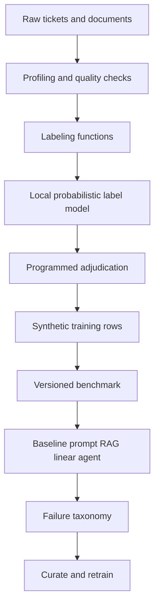

# Architecture

Enterprise Support Resolution is a local data-development loop. It classifies a support ticket, retrieves runbooks, drafts a resolution, and optionally selects a tool. The same held-out tickets score every iteration.

The raw set is generated in process. Gold types come from the generator and are used for evaluation and for reporting labeling-function accuracy. The label model fit does not read them.

V1 trains a token multinomial naive Bayes model on weak labels. V2 trains a local one-versus-rest linear model on a curated training set. The test ids do not change.

Retrieval is an in-process BM25 index with a hashed bag-of-words rerank. There is no external vector database.

Hosted LLM calls and LoRA training are recorded as `not-run` in `configs/models.yaml`.
